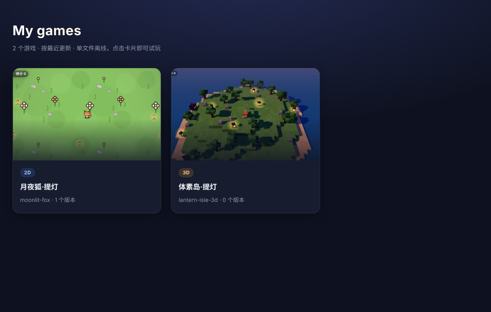
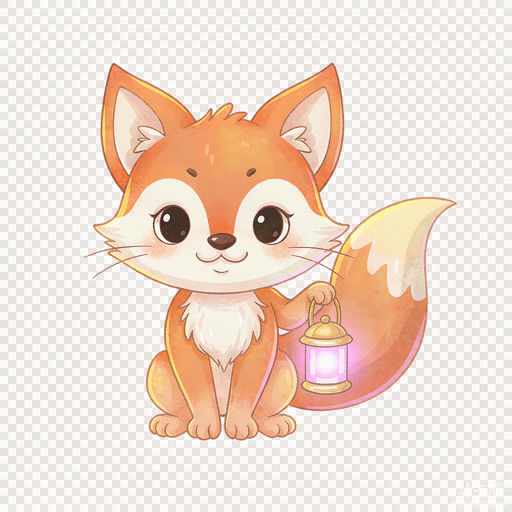

# wb-game-studio

[](https://github.com/cuic19053-hue/wb-game-studio/actions/workflows/check.yml) · MIT · Node 22+ · 零 npm 运行时依赖

> 一句话描述小游戏 → 生成可玩的 2D / 3D 游戏 → 自动试玩 → 换 AI 美术 → 导出**单个离线 HTML** / 游戏墙 / 临时分享链接。
> 全程本地运行，产物不发任何网络请求。

Describe a small game in plain words, build it from a template, playtest it in a headless browser, swap in AI art, and ship it as one self-contained HTML file. No account, no API key, no network at runtime.

| 2D · collector | 3D · voxel |
|---|---|
|  |  |

| 离线游戏墙（`wall` 产物） | AI 生成角色候选 |
|---|---|
|  |  |

**在线试玩**：[落地页](https://cuic19053-hue.github.io/wb-game-studio/) · [游戏墙（点击全屏试玩，Esc 返回）](https://cuic19053-hue.github.io/wb-game-studio/wall.html) · [2D 月夜狐·提灯](https://cuic19053-hue.github.io/wb-game-studio/2d.html) · [3D 体素岛·提灯](https://cuic19053-hue.github.io/wb-game-studio/3d.html)

## 这是什么

一个**平台无关的小游戏构建工具链**：核心是 `scripts/` 下约 1500 行纯 Node ESM，只用标准库，负责创建项目、内联打包单文件 HTML、驱动本机 Chrome 做自动试玩、管理 AI 美术候选与版本、生成游戏墙、开临时只读分享服务。

上面还有一层 `SKILL.md`，把它封装成 **WorkBuddy 技能**：对话里说一句「做个小游戏：小狐狸在竹林里收竹笋躲野猪」，Agent 就会按闸门流程生成、试玩、预览、交付。但这层只是入口，**工具本身不依赖 WorkBuddy**——纯命令行、其他 Agent、CI 里都能直接跑。

## 与上游的能力对齐（不缩水）

本项目是 [ZSeven-W/dsh-game-studio](https://github.com/ZSeven-W/dsh-game-studio)（MIT）的**平台移植与重写**，不是 git fork。上游绑死在 DeepSeek Harness 宿主运行时上，这里把能力全部搬到平台无关的实现：

| 上游 `game_studio_*` | 本项目命令 | 状态 |
|---|---|---|
| `create` | `create` | 对齐，另加 `--orientation` / `--lang` |
| `build` | `build` | 对齐，另加横竖屏 CSS、中英界面、three.js 共享标记 |
| `playtest` | `playtest` | 对齐：阶段/最高分/生命/fps/脚本错误/截图/封面/角色特写，支持 `window.__autoplay`、竖屏与横屏尺寸 |
| `generate_asset` | `asset generate` | 对齐：三通道（内置图像生成 / OpenAI / Codex）、1–4 张编号候选、参考图、花费审批卡、透明底检查 |
| `apply_asset` | `asset apply` | 对齐：按编号应用、自动重建 |
| `revert_asset` | `asset revert` | 对齐：回退上一张图、自动重建 |
| `versions` / `restore_version` | `versions` / `restore` | 对齐：代码、规则、美术一起恢复 |
| `export` | `export` | 对齐，另加外链扫描断言 |
| `share` | `share` | 对齐：只读、限时、局域网、二维码 |
| `list` | `list` | 对齐，另带版本数与封面 |
| `export_wall` | `wall` / `export-wall` | 对齐：按 2D/3D 过滤、按最近/版本数/名称排序、点击全屏试玩、Esc 返回、3D 共享一份 three.js |
| 侧边栏实时预览 / 按钮回调 | 结果区「网页」页签 + 对话指令 | 等价 |
| 自定义美术槽位 | `slots` + 哈希自动判 `custom` | 对齐 |
| 竖屏 / 横屏 | `--orientation` | 对齐 |
| 多语言 | `--lang zh\|en` + `locale/` | 对齐运行时（上游 locale 仅 en/zh） |
| 沙箱 CSP / 密钥不落盘 | 相同 | 对齐 |

**保留**：2D/3D 游戏模板（1768 行）、`game.json` 格式、`window.GAME` / `__gameState()` / `__renderSlots()` 契约、单文件内联打包思路。
**重写**：DSH 工具注册层、React 侧边栏 UI、TypeScript/esbuild 构建体系、全部运行时服务。
**超出上游的地方**：零 npm 运行时依赖（浏览器能力改用 Node 22 内置 WebSocket + Chrome DevTools 协议，不装 Playwright）、默认中文界面、AI 图片自动抠浅色背景、CI 冒烟测试、GitHub Pages 在线试玩。
**唯一没搬的**：上游 15 种语言的 README 文档（运行时语言上游本身只有 en/zh，已对齐）。

许可与第三方声明见 [LICENSE](LICENSE) 与 [NOTICE.md](NOTICE.md)。

## 快速开始（纯命令行）

要求 **Node.js 22+**（验证于 v22.22.2）；自动试玩与图片检查还需要本机 Chrome 或 Edge（可设 `CHROME_PATH`）。**不需要 `npm install`**。

```sh
git clone https://github.com/cuic19053-hue/wb-game-studio.git
cd wb-game-studio
STUDIO="$(pwd)/scripts/studio.mjs"

node "$STUDIO" create --dir ./games/fox --template collector \
  --title "月夜狐·提灯" \
  --rules '{"duration":60,"hearts":3,"enemySpeed":150}' \
  --slots '{"hero":{"label":"小狐狸"},"enemy":{"label":"荆棘怪"},"pickup":{"label":"灯笼"}}'

node "$STUDIO" build    --dir ./games/fox --note "首版"
node "$STUDIO" playtest --dir ./games/fox --seconds 8
node "$STUDIO" export   --dir ./games/fox
```

打开 `games/fox/dist/index.html` 就能玩；`export` 生成的 `月夜狐-提灯-offline.html` 是同一个自包含文件。

> 在 WorkBuddy 沙箱里运行时，所有命令请加 `env -u NODE_OPTIONS` 前缀：其 Node shim 会拦截新建目录，并把拒绝伪装成 `EEXIST: mkdir ...`。详见 [SKILL.md](SKILL.md)。

现成示例：`examples/moonlit-fox/dist/index.html`（2D，约 48 KB）、`examples/lantern-isle-3d/dist/index.html`（3D，约 740 KB）。

## 在 WorkBuddy 里用

把仓库复制或软链到 `~/.workbuddy/skills/wb-game-studio/`，`SKILL.md` 会被识别为技能：

```
做个 3D 游戏：小狐狸在体素岛上收灯笼，躲开荆棘怪，60 秒拿 20 分获胜
自动试玩一下 / 给主角换张 AI 图 / 回到上一版 / 导出成单个 HTML
```

技能按 G1 解析 → G2 定制构建 → G3 自动试玩 → G4 AI 美术 → G5 交付 逐闸门推进。

## 命令

所有命令输出一个 JSON 对象，失败时 `ok:false` + `error` / `code`（退出码 1）。

| 命令 | 作用 | 主要参数 |
|---|---|---|
| `create` | 从模板新建项目 | `--dir`、`--template collector\|voxel`、`--title`、`--rules JSON`、`--slots JSON`、`--orientation`、`--lang zh\|en`、`--force` |
| `build` | 构建单文件 HTML + 版本快照 | `--dir`、`--note` |
| `playtest` | 无头浏览器自动试玩 | `--dir`、`--seconds`、`--portrait`、`--characters` |
| `asset generate` | 生成编号美术候选 | `--slot`、`--provider builtin\|openai\|codex\|auto`、`--count 1-4`、`--prompt`、`--reference`、`--yes` |
| `asset stage` | 投放图片为候选（去背+缩放） | `--slot`、`--file`、`--label` |
| `asset list` / `apply` / `revert` | 列候选 / 按编号应用 / 回退 | `--slot`、`--number` |
| `versions` / `restore` | 版本历史 / 回滚 | `--dir`、`--id` |
| `export` | 导出离线 HTML | `--dir`、`--out` |
| `share` | 临时只读局域网链接 + 二维码 | `--dir`、`--seconds`、`--port`、`--no-wait` |
| `list` | 列出所有游戏 | `--root` |
| `wall` / `export-wall` | 导出离线游戏墙 | `--root`、`--filter`、`--sort`、`--out` |
| `locale` | 查看可用界面语言 | — |

`--rules` / `--slots` 为深合并，只写要改的字段；槽位设为 `null` 即删除。

## 自动试玩

`playtest` 用 Node 22 内置的 WebSocket 连本机 Chrome 的 DevTools 协议（**不依赖 playwright / puppeteer**），打开构建产物、自动按键驱动、按 160 ms 采样 `window.__gameState()`，输出：

```json
{
  "phases": [{"phase":"title","at":0},{"phase":"playing","at":0.9}],
  "bestScore": 0, "hearts": 3,
  "fps": {"avg": 45.1, "min": 8.8, "max": 51},
  "errorCount": 0,
  "screenshot": ".../frame.png", "cover": ".../cover.jpg",
  "characters": [".../character-hero.png"]
}
```

非方向键玩法（三消、卡牌、音游、瞄准）可自己实现 `window.__autoplay(state)`，试玩会改用它跑真实循环。方向键玩法会自动朝最近的收集物移动。`--characters` 用 `window.__renderSlots(256)` 导出代码画的角色特写。封面 `cover.jpg` 供游戏墙使用。

## AI 美术与候选

| 通道 | 用法 | 计费 |
|---|---|---|
| 内置图像生成 | 由 WorkBuddy 技能生成图片 → `asset stage` 投放 | 平台积分（生成前需告知用户） |
| OpenAI | `asset generate --provider openai --yes` | 按图片计费到自己的 key，默认先出**花费审批卡** |
| Codex CLI | `asset generate --provider codex` | 计入本机 Codex 套餐，不需要 API key |

`asset stage` 会检查透明底、自动抠掉浅色背景、等比拟合到槽位尺寸并编号；CLI 不访问宿主模型，因此 `builtin` 通道返回交接指令而**不伪造生成结果**。
`asset apply --number N` 写入素材、更新 `game.json`、自动重建，`build` 会通过哈希比对把该槽标记为 `custom: true`；`asset revert` 从 `.studio/asset-backups/` 恢复。


## 游戏墙与分享

`wall` 把当前筛选/排序下的游戏打包成一个离线 HTML：封面来自最近一次试玩，点击全窗口试玩、Esc 返回；多个 3D 游戏只内联一份 three.js。未构建的游戏会被列进 `excluded` 而不静默跳过。


`share` 起一个临时只读 HTTP 服务：只服务当前游戏的一个 HTML、POST 返回 405、绑定局域网地址、附带二维码 SVG、到时自动关闭。

## 项目结构

```
wb-game-studio/
├── SKILL.md                     # WorkBuddy 技能入口（闸门工作流）
├── scripts/
│   ├── studio.mjs               # CLI 与命令注册
│   ├── browser.mjs              # 零依赖 Chrome CDP 驱动
│   ├── playtest.mjs             # 自动试玩与报告
│   ├── assets.mjs               # 候选、审批、三通道生成、应用/回退
│   ├── share.mjs                # 只读分享服务 + 二维码
│   ├── wall.mjs                 # 游戏墙导出
│   └── i18n.mjs                 # 中英界面替换
├── references/game-contract.md  # window.GAME / __gameState 契约
├── assets/
│   ├── templates/{collector,voxel}/  # 2D / 3D 模板 + SVG 素材
│   └── vendor/{three.min.js,qrcode.js}
├── locale/{zh,en}.json
├── examples/                    # 两个可直接打开的单文件示例
├── docs/screenshots/            # 实测截图（含 AI 素材、游戏墙）
├── test/smoke.mjs               # Node 内置测试
└── .github/workflows/check.yml  # CI
```

游戏项目目录：

```
<game>/
├── game.json        # title / template / slots / rules / runtime / orientation / lang
├── game.js          # 游戏代码
├── assets/          # 美术槽位 + ASSETS.json
├── dist/index.html  # 单文件离线构建
└── .studio/         # versions / candidates / asset-backups / playtests / cover / share-qr
```

## 离线保证

产物带以下 CSP，所有图片在构建前转成 data URL 内联：

```
default-src 'none'; img-src data: blob:; media-src data: blob:;
font-src data:; style-src 'unsafe-inline'; script-src 'unsafe-inline';
connect-src 'none'; form-action 'none'
```

3D 把 `assets/vendor/three.min.js` 整份内联，不加载 CDN。`export` 检查 `<script src>`、`<link href>`、远程 ``、`<iframe>`，全通过才返回 `offline: true`。API key 只从环境变量读取，不写进项目、日志或工具结果。

> 选 three.js **r160.1** 是因为 0.187 起官方不再提供可直接内联的 UMD 构建；模板只用到基础几何、材质、精灵与渲染器 API，r160.1 完全覆盖。

## 验证

```sh
node --test test/smoke.mjs          # 13 个用例
WB_SKIP_BROWSER=1 node --test test/smoke.mjs   # 强制跳过浏览器用例
```

CI 在 Node 22 上跑全部冒烟用例；找不到 Chrome/Edge 时浏览器用例自动跳过（可用 `CHROME_PATH` 指定浏览器）。**13 个用例实测全绿**：两套模板的 create/build/export、3D 运行时内联、自动试玩（2D 竖屏 + 3D WebGL，采样/fps/脚本错误/截图/封面）、AI 图片自动去背与应用回退、三通道出图与 OpenAI 花费审批、游戏墙过滤/排序/共享 three.js、分享服务只读 GET/HEAD + 405/404 + 二维码 + CLI、版本回滚、中英界面与横竖屏、离线外链扫描。

AI 美术链路的测试用例使用一张代码生成的确定性 PNG（白底 + 橙色方块），验证抠图逻辑时**不消耗任何积分、不调用任何外部 API**。

## 许可

MIT。原始模板与打包思路来自 MIT 协议的 `ZSeven-W/dsh-game-studio`；three.js、qrcode-generator 同为 MIT。完整声明见 [NOTICE.md](NOTICE.md)。
