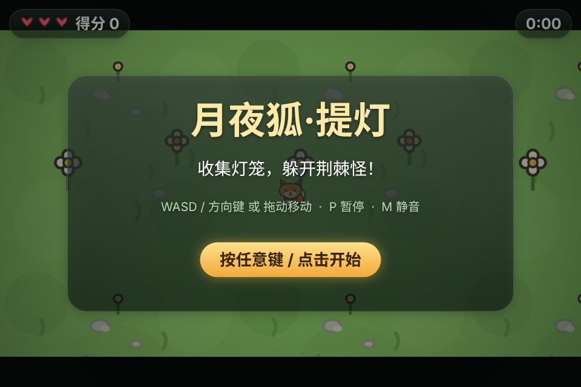
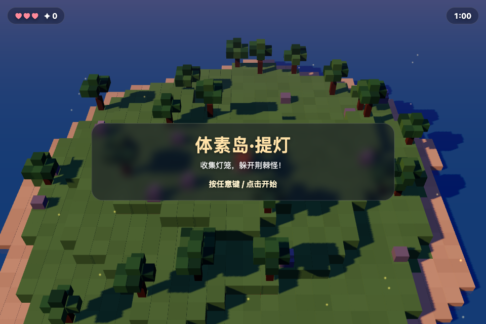

# wb-game-studio

> 一句话描述小游戏 → 生成可玩的 2D / 3D 游戏 → 导出**单个离线 HTML 文件**。
> 零第三方依赖、免登录、免 API key、全程本地运行，产物不发任何网络请求。

Describe a small game in plain words, build it from a template, play it locally, and ship it as one self-contained HTML file. No account, no API key, no network at runtime.

| 2D · collector | 3D · voxel |
|---|---|
|  |  |

**在线试玩**：[游戏墙](https://cuic19053-hue.github.io/wb-game-studio/) · [2D 月夜狐·提灯](https://cuic19053-hue.github.io/wb-game-studio/2d.html) · [3D 体素岛·提灯](https://cuic19053-hue.github.io/wb-game-studio/3d.html)

## 这是什么

一个**平台无关的小游戏构建工具链**：核心是 `scripts/studio.mjs`（367 行、只用 Node 标准库），负责从模板创建项目、把 `game.json` / `game.js` / 图片内联打包成单文件 HTML、管理版本快照、校验离线、导出交付文件。

在本仓库之上还有一层 `SKILL.md`，把它封装成 **WorkBuddy 技能**：在对话里说一句「做个小游戏：小狐狸在竹林里收竹笋躲野猪」，Agent 就会按流程生成、预览、交付。但这层只是入口，**工具本身不依赖 WorkBuddy**——纯命令行、其他 Agent、CI 里都能直接跑。

## 与上游的关系

本项目是 [ZSeven-W/dsh-game-studio](https://github.com/ZSeven-W/dsh-game-studio)（MIT）的**平台移植与精简重写**，不是 git fork。

| | 上游 | 本项目 |
|---|---|---|
| 运行平台 | DeepSeek Harness 宿主插件 | 任意 Node 22+ 环境 |
| 代码 | 4344 行 TypeScript + esbuild + DSH SDK | 367 行纯 Node ESM，零依赖 |
| 保留 | — | 2D/3D 游戏模板（1768 行）、`game.json` 格式、`window.GAME` / `__gameState` / `__renderSlots` 契约、单文件内联打包思路 |
| 重写 | — | 创建 / 构建 / 版本 / 导出 / 列表 / 回滚 |
| 移除 | — | DSH 工具注册、React 侧边栏、OpenAI/Codex 出图、花费审批、自动试玩、游戏墙、LAN 分享 |

上游模板的界面文案已中文化。许可与第三方声明见 [LICENSE](LICENSE) 和 [NOTICE.md](NOTICE.md)。

## 快速开始（纯命令行）

要求：**Node.js 22 或更新**（本机验证于 v22.22.2），无需 `npm install`。

```sh
git clone https://github.com/cuic19053-hue/wb-game-studio.git
cd wb-game-studio

S="$(pwd)"
STUDIO="$S/scripts/studio.mjs"

node "$STUDIO" create --dir ./games/fox --template collector \
  --title "月夜狐·提灯" \
  --rules '{"duration":60,"hearts":3,"enemySpeed":150}' \
  --slots '{"hero":{"label":"小狐狸"},"enemy":{"label":"荆棘怪"},"pickup":{"label":"灯笼"}}'

node "$STUDIO" build  --dir ./games/fox --note "首版"
node "$STUDIO" export --dir ./games/fox
```

用浏览器打开 `games/fox/dist/index.html` 就能玩；`export` 生成的 `月夜狐-提灯-offline.html` 是同一个自包含文件，可随意复制、托管或发给别人。

> 在 WorkBuddy 沙箱里运行时，所有命令请加 `env -u NODE_OPTIONS` 前缀：其 Node shim 会拦截新建目录，并把拒绝伪装成 `EEXIST: mkdir ...`。详见 [SKILL.md](SKILL.md)。

不想从头建？仓库里有两个现成示例，直接打开即可：
`examples/moonlit-fox/dist/index.html`（2D，约 45 KB）、`examples/lantern-isle-3d/dist/index.html`（3D，约 740 KB）。

## 在 WorkBuddy 里用

把本仓库复制或软链到 `~/.workbuddy/skills/wb-game-studio/`，`SKILL.md` 会被识别为技能。之后直接用自然语言提需求：

```
做个 3D 游戏：小狐狸在体素岛上收灯笼，躲开荆棘怪，60 秒拿 20 分获胜
帮我给主角换张图 / 回到上一版 / 导出成单个 HTML 发给别人
```

技能会判断 2D/3D、解析胜负条件、改 `game.json` 与 `game.js`、构建并在结果区预览，最后导出单文件。

## 命令

所有命令输出一个 JSON 对象，失败时 `ok:false` 并带 `error` / `code`。

| 命令 | 作用 | 主要参数 |
|---|---|---|
| `create` | 从模板新建项目 | `--dir`（必填）、`--template collector\|voxel`、`--title`、`--rules JSON`、`--slots JSON`、`--orientation`、`--force` |
| `build` | 构建成单文件 HTML，记录版本快照 | `--dir`、`--note` |
| `export` | 导出交付文件并校验无外链 | `--dir`、`--out` |
| `list` | 列出工作区里的游戏 | `--root` |
| `versions` | 查看版本历史 | `--dir` |
| `restore` | 回滚到某版本（同时恢复代码/规则/美术并自动重建） | `--dir`、`--id` |

`--rules` / `--slots` 为深合并，只写要改的字段；`--slots` 中把槽位设为 `null` 可删除它。

## 项目结构

```
wb-game-studio/
├── SKILL.md                     # WorkBuddy 技能入口（工作流与铁律）
├── scripts/studio.mjs           # 零依赖核心 CLI
├── references/game-contract.md  # window.GAME / __gameState 等契约
├── assets/
│   ├── templates/{collector,voxel}/  # 2D / 3D 模板 + 默认 SVG 素材
│   └── vendor/three.min.js      # three.js r160.1 UMD，构建时内联
├── examples/                    # 两个可直接打开的单文件示例
├── docs/screenshots/            # 实测截图
├── test/smoke.mjs               # Node 内置测试
└── .github/workflows/check.yml  # CI
```

游戏项目目录：

```
<game>/
├── game.json        # title / template / slots / rules / runtime
├── game.js          # 游戏代码，改这里
├── assets/          # 每个美术槽位的图 + ASSETS.json
├── dist/index.html  # 当前构建，单文件离线
└── .studio/         # versions.json + 每次构建的快照
```

## 换美术

直接覆盖 `assets/<slot>.svg`，或在 `game.json` 里把该槽的 `file` 改成自己的 PNG，然后重新 `build`。**不需要登记命令**：构建时会自动比对素材与模板原文件的哈希，不同就把该槽标记为 `custom: true`，模板随即用图片替代代码画的角色。`build` 返回的 `customSlots` 会告诉你哪些槽生效了。

## 离线保证

产物带以下 CSP，且所有图片在构建前转成 data URL 内联：

```
default-src 'none'; img-src data: blob:; media-src data: blob:;
font-src data:; style-src 'unsafe-inline'; script-src 'unsafe-inline';
connect-src 'none'; form-action 'none'
```

3D 项目把 `assets/vendor/three.min.js` 整份内联进 HTML，不加载 CDN。`export` 会检查 `<script src>`、`<link href>`、远程 ``、`<iframe>`，全部通过才返回 `offline: true`。

> 选 three.js **r160.1** 是因为 0.187 起官方不再提供可直接内联的 UMD 构建；模板只用到基础几何、材质、精灵与渲染器 API，r160.1 完全覆盖。

## 现状与路线图

已实现并验证：2D/3D 生成、中文界面、单文件离线导出、覆盖图片自动识别、版本快照与回滚、无外链校验、CI 冒烟测试。2D 与 3D 都用无头 Chrome 截图确认过真实渲染。

尚未实现：自动试玩（headless Playwright 读 `__gameState`）、AI 生成美术候选、游戏墙批量导出、一键发布公网链接。上游已有这些能力的实现，可作为移植参考。

## 验证

```sh
node --test test/smoke.mjs
```

测试覆盖两套模板的 create → build → export、离线断言、3D 运行时内联、自定义素材识别、版本回滚与 list。CI 在 Node 22 上自动运行，不需要安装浏览器。

## 许可

MIT。原始模板与打包思路来自 MIT 协议的 `ZSeven-W/dsh-game-studio`；three.js 同为 MIT。完整声明见 [NOTICE.md](NOTICE.md)。
